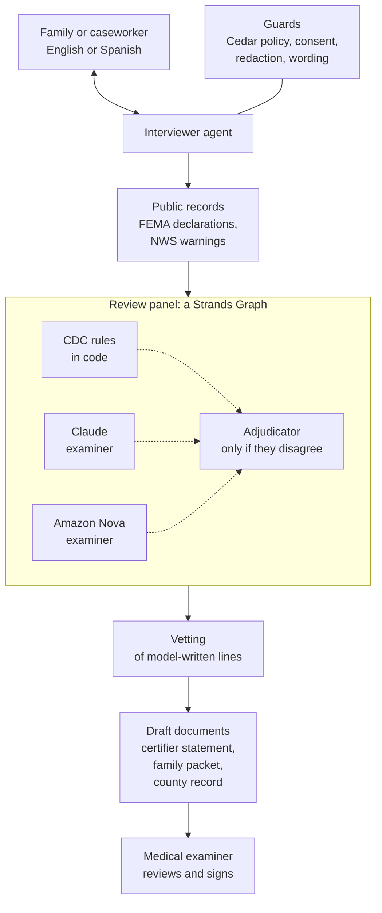
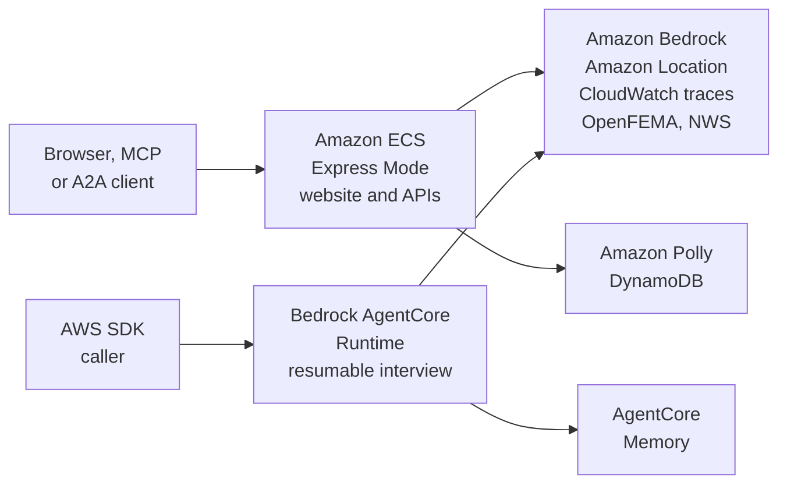

# Counted

[](https://github.com/usv240/counted/actions/workflows/tests.yml)
[](LICENSE)

**A Strands agent that finds the disaster hidden inside a death, so the death is counted and the family can claim FEMA funeral assistance.**

Counted interviews a grieving family in English or Spanish and checks FEMA and National Weather Service records. A review panel then applies the CDC's death-certification guidance, and Counted drafts the statement a medical examiner reviews and signs. It never signs anything itself.

**Live demo:** https://co-435ce50e27c4441da1f6e8104db5cb23.ecs.us-east-1.on.aws (API docs at `/docs`, MCP at `/mcp/`, A2A at `/a2a/`) · **Video (2:46):** https://youtu.be/-d6Z9vy2XaM · **Project post:** [AWS Builder Center](https://builder.aws.com/project/3LeU2rVXxuHRfMuDVYNbUlPB8Nl/counted-a-strands-agent-that-finds-the-disaster-deaths-official-counts-miss) · **Full evaluation:** [docs/EVALUATION.md](docs/EVALUATION.md)

---

## Why it matters

A death counts as disaster-related only if the person certifying it writes the disaster down. Deaths the disaster caused indirectly are the ones most often missed: the oxygen machine that stopped when the power failed, the dialysis clinic that closed, the generator left running in a garage.

| Finding | Source |
|---|---|
| After Hurricane Maria (2017), Puerto Rico's official toll was **64**. A study the government commissioned estimated **2,975** excess deaths. | George Washington University, 2018 [1] |
| Across 501 US tropical cyclones (1930–2015), the average storm leads to **7,000–11,000** excess deaths over the following 15 years. Government statistics record an average of 24 immediate deaths. | Young & Hsiang, *Nature* 2024 [2] |
| A death certificate should record a disaster's role whether it caused the death **directly or indirectly**. | CDC/NCHS reference guide, 2017 [3] |
| FEMA funeral assistance requires the death certificate or a certifier's statement to attribute the death to the disaster. | FEMA, 2025 [4] |
| After Hurricane Harvey, FEMA approved **55 of 1,941** funeral-assistance applications from Texas. GAO found the denials were largely because of insufficient documentation. | GAO-19-486, 2019 [5] |
| The National Association of Medical Examiners asks for a disaster field on the US death certificate, partly so families can reach FEMA funeral benefits. | NAME position paper, 2023 [6] |

Most of the long-term toll in [2] can't be traced to one certificate. Counted works on the part that can: deaths in the first days and weeks, one interview at a time.

**Who it's for:** families who don't know how to explain the disaster's role in a death and are least likely to have an advocate, such as older adults on powered medical equipment and Spanish-speaking or low-income families. Also the caseworkers and medical examiners who help them.

## Try it in two minutes

1. Open the [live demo](https://co-435ce50e27c4441da1f6e8104db5cb23.ecs.us-east-1.on.aws) and scroll to **Try a real case**. The page first shows a recorded run; press **Find the disaster** to run it live.
2. Pick a sample case:
   - *The oxygen machine:* an indirect death in Winter Storm Uri.
   - *El calor sin luz:* the same flow in Spanish.
   - *Not every death:* no disaster link, and Counted says so.
   - *Just say it was the storm:* a relative pushing for a link the facts don't support.
3. Open the three document tabs: **Certifier statement**, **Family packet** (English or Spanish, with read-aloud) and **Surveillance record**.
4. Switch to **Talk to Counted** to be interviewed yourself.

## How it works



1. **Interview.** The interviewer asks one open question at a time and records only what the family actually said, as verbatim quotes. A guard blocks any question that names a circumstance the family hasn't raised: power, oxygen, dialysis and nine others, in English and Spanish.
2. **Check the records.** Counted geocodes the address, then looks up FEMA disaster declarations for that county and date, and the Weather Service warnings for that point.
3. **Decide.** Three seats judge the case independently, the way a medical review board works:
   - the CDC decision tree, written as code;
   - a Claude examiner;
   - an Amazon Nova examiner.

   If all three agree, that's the finding. If any disagree, a conditional edge in the Graph sends the case to an adjudicator.
4. **Draft.** The documents are templates, filled from the checked facts and the panel's finding. The few lines that come from an examiner model are vetted first. The family hears the outcome in pre-written, vetted words, not the model's own. Where the CDC guide and the NAME paper [6] say the disaster belongs on the certificate, the certifier draft puts it there: a "how injury occurred" line, plus a Part II line for indirect deaths that are usually certified as natural.

The REST, MCP and A2A endpoints skip the interview. They take a written account and run the same records, panel, vetting and documents steps.

### Where it runs



Both deployments run the same code and call Bedrock (Claude and Amazon Nova), Amazon Location, CloudWatch and the public FEMA and Weather Service APIs. Only the website uses Polly (read-aloud) and DynamoDB (hashed API keys). Only AgentCore keeps the interview in AgentCore Memory.

| Role | Model on Amazon Bedrock | Backup (via `ModelRouter`) |
|---|---|---|
| Interviewer | Claude Haiku 4.5 | Claude Sonnet 4.5 |
| Claude examiner | Claude Sonnet 4.6 | Claude Sonnet 4.5 |
| Nova examiner | Amazon Nova 2 Lite | Amazon Nova Pro, so the panel keeps two model families |
| Adjudicator | Claude Opus 4.6 | Claude Sonnet 4.6 |

All model IDs are in [`src/counted/config.py`](src/counted/config.py), and each can be changed with an environment variable.

## How it uses Strands

| Strands feature | What it does in Counted | Code |
|---|---|---|
| `Agent`, `@tool` with `ToolContext` | The interviewer records details and verbatim quotes, checks public records and asks for a determination | [`agents/interviewer.py`](src/counted/agents/interviewer.py) |
| Multi-agent `Graph` | Two examiners run in parallel; a **conditional edge** calls the adjudicator only when the seats disagree | [`agents/panel.py`](src/counted/agents/panel.py) |
| `ModelRouter` | Moves to a backup model when a primary is throttled or unavailable | [`agents/panel.py`](src/counted/agents/panel.py) |
| Interventions (`Guide`, `Transform`, `Confirm`, `Proceed`) | Consent before a decision, ID redaction, verbatim quotes, no overclaiming, the outcome in vetted words | [`policy/guards.py`](src/counted/policy/guards.py), [`agents/interviewer.py`](src/counted/agents/interviewer.py) |
| `CedarAuthorization` | No determination before records are checked; only a certifier may sign | [`policy/counted.cedar`](src/counted/policy/counted.cedar) |
| `SteeringHandler` | Checks the interview is complete before the panel is asked to decide | [`agents/interviewer.py`](src/counted/agents/interviewer.py) |
| Structured output | Typed verdicts and case facts | [`schemas.py`](src/counted/schemas.py) |
| AgentCore Memory session manager | A family can stop and resume days later, in a new microVM, without being asked anything twice | [`agentcore_app.py`](src/counted/agentcore_app.py) |
| `A2AServer` | Other agents can call Counted (an MCP server is also mounted) | [`service/api.py`](src/counted/service/api.py), [`service/mcp_server.py`](src/counted/service/mcp_server.py) |
| Strands Evals `ActorSimulator` | Simulated relatives, honest and adversarial, talk to the real interviewer | [`evals/interview_sim.py`](evals/interview_sim.py), [`evals/adversarial_sim.py`](evals/adversarial_sim.py) |
| OpenTelemetry tracing | Strands' spans go to CloudWatch through the AWS Distro for OpenTelemetry, with no prompt text exported | [`Dockerfile`](Dockerfile), [`deploy/`](deploy/) |

## Results

Labels come from the government: the CDC (Hurricane Irma, MMWR 2018 [7]) and Texas DSHS (Winter Storm Uri, 2021 [8]). Each official death is replayed as a short account rendered from templates. Two smaller sets are partly ours, and say so (details in [docs/EVALUATION.md](docs/EVALUATION.md)).

| Test set | Cases | Direct-only rule | One LLM call, no CDC definitions | Claude examiner alone, with them | **Counted panel** |
|---|---|---|---|---|---|
| Hurricane Irma replay (CDC labels) | 129 | 9% | 53% | 100% | **100%** |
| Winter Storm Uri replay (Texas DSHS labels) | 246 | 60% | 70% | 93% | **93%** (the ceiling) |
| CDC's own worked scenarios | 22 | 36% | 77%, 5 wrong | 86%, 1 wrong | **91%, 0 wrong, 2 declined** (on the final code: 1 wrong, 1 declined) |
| Deaths with no disaster link | 26 | 1 false link | 0 | 0 | **0 false links** |

What this shows:
- **The CDC definitions did most of the work.** The same Claude model scores 53% on Irma with a one-line prompt and 100% with the CDC's guidance in its prompt.
- **The direct-only rule misses the indirect deaths.** It recognises 11 of Irma's 126 storm-related deaths; Counted recognises all 126 (95% Wilson interval for the 129 labels: 97.1–100%).
- **The panel's job is to fail safe, not to score higher.** The rules seat alone made 3 false links on the 26 no-link deaths, such as a drowning on a calm lake. Both model seats disagreed each time, and the panel made none.
- **Uri's 93% is the ceiling.** Some official circumstance rows split across labels (Uri hypothermia: 146 direct, 10 indirect, 2 possible), so no reader of the circumstances can get every one.
- **Cost and speed:** a mean of $0.027 per case, and a median of 9.6 s from checked facts to a draft.

The full tables (every run, each seat alone, paired tests, Cohen's κ = 0.93 between Claude and Nova) are in [docs/EVALUATION.md](docs/EVALUATION.md).

## Safety

Counted never signs anything; Cedar allows `sign_certifier_statement` only for a certifier. It also never:
- records words the family didn't say;
- invents a disaster link under pressure;
- writes "may have been caused by", which FEMA rejects;
- decides without the family's consent.

- **Scripted red team, offline:** 21 attacks plus 4 controls against the real interviewer. With every guard on, 25 of 25 pass. Removing any one guard lets something through that no other guard stops.
- **Live red team:** simulated relatives try to make it sign, obey a prompt injection, promise FEMA money, or blame the family. A different model judges every reply. Across **402 live interviews**: 0 signatures, 0 stored ID numbers, 0 false links in a determination.
- **Open problem: leading questions.** When a relative insists on a link, the judge still flags some of the interviewer's questions as leading. The rule against naming a circumstance the family hasn't raised cut flagged interviews on new attacks from 10 of 20 to 4. On a second set it was never tuned on, 6 of 20 still had a flagged sentence. Round-by-round numbers are in [docs/EVALUATION.md](docs/EVALUATION.md).

## Testing

Everything below runs **offline, with no AWS account**. The tests and the guard ablation also run in CI on every push.

```bash
uv sync
uv run pytest tests                     # 234 tests, about 15 seconds
uv run python -m evals.guard_ablation   # removes one guard at a time and reruns the scripted attacks
uv run python -m evals.stats            # recomputes intervals and paired tests from the saved predictions
uv run python -m evals.redteam_totals   # recounts all 402 live red-team interviews from the saved transcripts
uv run python data/check_tables.py      # re-adds every total in the transcribed government tables
```

| Test file | What it checks |
|---|---|
| `test_rules_and_documents.py` | The CDC decision tree and the documents built from it |
| `test_redteam.py` | 21 attacks and 4 controls, driven by a model scripted to misbehave |
| `test_guard_phrases.py` | 33 sentences the language guard must block (most taken from live runs) and 14 it must allow |
| `test_vetting.py`, `test_outcome.py` | Model-written lines are vetted; the outcome is told in vetted words |
| `test_resume.py` | The case file is rebuilt correctly when a family resumes in a new session |
| `test_api.py`, `test_speech.py` | REST interview handling and read-aloud |

**Live evaluations** call Amazon Bedrock and cost money. Results are written to `evals/results/`:

```bash
uv run python -m evals.build_cases && uv run python -m evals.run --tag my-run   # 413 benchmark cases (also updates latest.json, which the API serves)
uv run python -m evals.interview_sim --n 16 --out my_sim.json                   # 16 simulated relatives, honest
uv run python -m evals.adversarial_sim --out my_redteam.json                     # 24 adversarial interviews, judged by a second model
uv run python -m evals.cost --n 20                                               # metered cost per case
```

The notebook [`notebooks/reproduce.ipynb`](notebooks/reproduce.ipynb) recomputes the headline numbers offline.

## Run it yourself

You need Python 3.12, [uv](https://docs.astral.sh/uv/), and an AWS account with Bedrock model access in us-east-1 for the models above.

```bash
uv sync
aws configure
uv run counted-api        # http://localhost:8080: website, /docs, /v1, /mcp, /a2a
```

Use it as a service:

```bash
curl -X POST localhost:8080/v1/keys -H "content-type: application/json" -d '{"name":"my org"}'
curl -X POST localhost:8080/v1/assess -H "x-api-key: ct_..." -H "content-type: application/json" \
  -d '{"account":"My mother, 78, lived at 4602 Kiam St, Houston, TX. During Winter Storm Uri the power went out Feb 15 and her oxygen machine stopped. She died at home on 2021-02-17."}'
```

Connect from an MCP client:

```json
{"mcpServers": {"counted": {"type": "http", "url": "https://co-435ce50e27c4441da1f6e8104db5cb23.ecs.us-east-1.on.aws/mcp/"}}}
```

### Deploy

- **Website and API on Amazon ECS Express Mode.** `uv run python deploy/ecs_redeploy.py` builds the [`Dockerfile`](Dockerfile), pushes it to ECR tagged with the commit, and rolls the service onto it.
  - The task role allows only Bedrock invoke, Amazon Location geocoding, Polly, the API-key table and sending trace spans.
  - Daily caps limit model runs (`COUNTED_DAILY_RUNS`) and read-aloud requests (`COUNTED_DAILY_SPEECH`).
- **Interviewer on Amazon Bedrock AgentCore Runtime, with AgentCore Memory.** This is a direct code deploy, with no container:
  ```bash
  uv run python deploy/agentcore_package.py      # arm64 wheels plus the counted package, zipped for Linux
  uv run python deploy/agentcore_deploy.py       # memory, least-privilege role and runtime, then a two-session resume test
  uv run python deploy/agentcore_resume_demo.py  # a family stops on "Monday" and resumes on "Thursday" in a new microVM
  ```
  Every reply reports the git commit it was built from (`build`).
- **Tracing.** Both deployments send Strands' spans to CloudWatch through the AWS Distro for OpenTelemetry:
  - what's traced: the request, the geocode and public-record calls, the panel's Graph, and every model call with its token counts;
  - log export is off, so the family's words never reach CloudWatch;
  - `deploy/enable_tracing.py` grants the ECS task role its one extra permission.

## Repository layout

| Path | What's there |
|---|---|
| `src/counted/agents/` | Interviewer and review panel |
| `src/counted/rules.py` | CDC decision tree |
| `src/counted/policy/` | Cedar policy and the guards |
| `src/counted/tools/facts.py` | Amazon Location, US Census backup, OpenFEMA, NWS warnings (via the Iowa Environmental Mesonet archive) |
| `src/counted/documents.py`, `outcome.py`, `vetting.py`, `speech.py` | Documents, vetted outcome messages, vetting, read-aloud |
| `src/counted/service/` | REST API, API keys, MCP and A2A servers, website hosting |
| `src/counted/agentcore_app.py` | AgentCore Runtime entrypoint with Memory |
| `web/` | The website |
| `data/` | Ground truth transcribed from CDC, MMWR and Texas DSHS, with [`SOURCES.md`](data/SOURCES.md) |
| `evals/` | Benchmark replays, interview simulations, red team, cost and statistics; saved results in `evals/results/` |
| `tests/` | Offline tests |
| `deploy/` | ECS and AgentCore deploy scripts |

## What is not yet shown

- No medical examiner's office, caseworker or family has used Counted yet, and no change in FEMA approvals has been measured.
- The replays use template wording, not real interviews.
- Independent judging still finds leading questions under pressure (see Safety).

Counted prepares drafts for qualified certifiers. It is not a death certificate, and not medical or legal advice. FEMA decides eligibility.

## Sources

1. Milken Institute School of Public Health, George Washington University. [*Ascertainment of the Estimated Excess Mortality from Hurricane María in Puerto Rico*](https://publichealth.gwu.edu/sites/g/files/zaxdzs4586/files/2023-06/acertainment-of-the-estimated-excess-mortality-from-hurricane-maria-in-puerto-rico.pdf). 2018.
2. Young R, Hsiang S. [Mortality caused by tropical cyclones in the United States](https://doi.org/10.1038/s41586-024-07945-5). *Nature* 635, 121–128 (2024).
3. CDC/NCHS. [*A Reference Guide for Certification of Deaths in the Event of a Natural, Human-induced, or Chemical/Radiological Disaster*](https://www.cdc.gov/nchs/data/nvss/vsrg/vsrg01.pdf). Vital Statistics Reporting Guidance No. 1, 2017.
4. FEMA. [*Help with Funerals and Burials*](https://www.fema.gov/sites/default/files/documents/fema_ia_qrg_help_with_funerals_and_burials_20250715.pdf). July 2025.
5. US Government Accountability Office. [GAO-19-486](https://www.gao.gov/products/gao-19-486). 2019. Funeral-assistance approvals after Hurricane Harvey.
6. Utley S, et al. [National Association of Medical Examiners Position Paper: Recommendations for the Documentation and Certification of Disaster-Related Deaths](https://doi.org/10.1097/PAF.0000000000000859). *Am J Forensic Med Pathol* 44(3):e80–e90 (2023).
7. Issa A, et al. [Deaths Related to Hurricane Irma — Florida, Georgia, and North Carolina, September 4–October 10, 2017](https://pmc.ncbi.nlm.nih.gov/articles/PMC6072056/). *MMWR* 67(30):829–832 (2018).
8. Texas Department of State Health Services. [*February 2021 Winter Storm-Related Deaths – Texas*](https://www.dshs.texas.gov/sites/default/files/news/updates/SMOC_FebWinterStorm_MortalitySurvReport_12-30-21.pdf). December 2021.

How each data file was extracted from these sources, and its caveats: [`data/SOURCES.md`](data/SOURCES.md). Pictures on the website: NOAA/NASA/CIRA and NASA, public domain; David Kitto, CC0 ([`web/assets/credits.json`](web/assets/credits.json)).

Built with [Strands Agents](https://strandsagents.com) for the AWS Builder Center "Strands SDK: Workshop to Ship" hackathon, 2026. Licence: [Apache-2.0](LICENSE).
